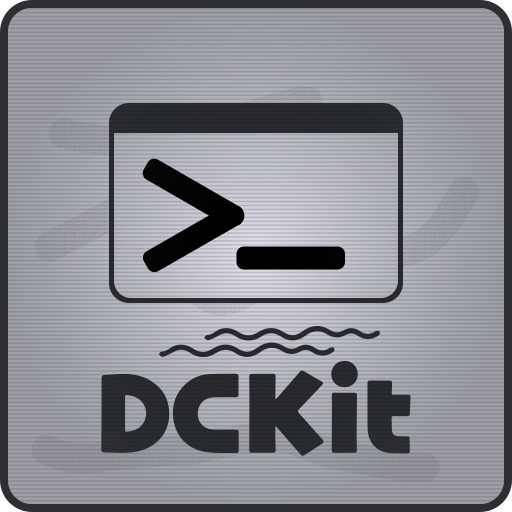

<div align="center">



# DCKit Demo

<p><strong>An interactive Godot 4 project showcasing DCKit's developer console framework.</strong></p>

[](https://godotengine.org)
[](LICENSE)
[](https://github.com/Brahmbir/DCKit)

</div>

---

DCKitDemo is a sample Godot project built to demonstrate the features, capabilities, and integration of [DCKit](https://github.com/Brahmbir/DCKit).

Rather than being a standalone application, this repository provides a hands-on environment where you can explore the developer console, experiment with commands, inspect its behaviour, and understand how DCKit can be integrated into your own Godot projects.

## Getting Started

### Requirements

- Godot Engine 4.x
- Git

### Clone the repository

Clone the repository along with its submodules:

```bash
git clone --recurse-submodules https://github.com/Brahmbir/DCKitDemo.git
```

If you have already cloned the repository without submodules:

```bash
git submodule update --init --recursive
```

### Open the project

1. Open Godot Engine.
2. Select **Import**.
3. Navigate to the cloned `DCKitDemo` directory.
4. Select `project.godot`.
5. Run the project.

## Exploring the Demo

The demo project provides an environment to experiment with DCKit's functionality.

You can explore:

- **Developer Console:** Interact with the in-game console and experiment with commands.
- **Command Registration:** See how custom commands are registered and exposed to the console.
- **Command Execution:** Experiment with arguments, variables, constructors, and nested commands.
- **Variable Store:** Explore how console variables can be accessed and modified.
- **Integration:** See how gameplay code communicates with the DCKit API.

The demo is also useful as a reference when integrating DCKit into an existing Godot project.

## DCKit Add-on

The actual framework lives in a separate repository:

**[Brahmbir/DCKit](https://github.com/Brahmbir/DCKit)**

DCKit is included in this project as a Git submodule:

```text
DCKitDemo/
├── addons/
│   └── dckit/           # DCKit Git submodule
├── ...
├── project.godot
└── README.md
```

Keeping the add-on separate allows the framework and demo project to evolve independently.

You can explore the add-on repository for its architecture, API reference, installation instructions, and development details.

## Contributing

Contributions, bug reports, and suggestions are welcome.

If you encounter an issue with the demo project, please open an issue in this repository.

For issues related to the core console framework, use the [DCKit repository](https://github.com/Brahmbir/DCKit).

## License

This project is distributed under the MIT License. See [LICENSE](LICENSE) for details.

---

<div align="center">
<sub>Built with Godot 4 · Powered by DCKit · MIT License</sub>
</div>
